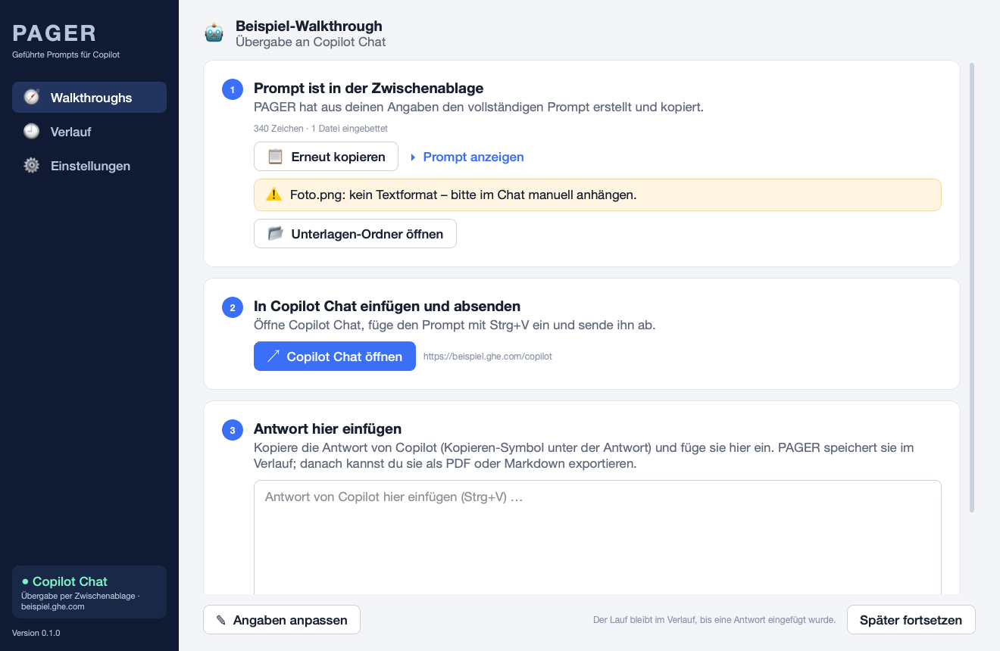
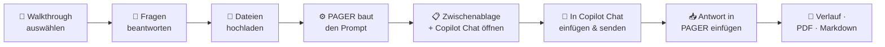
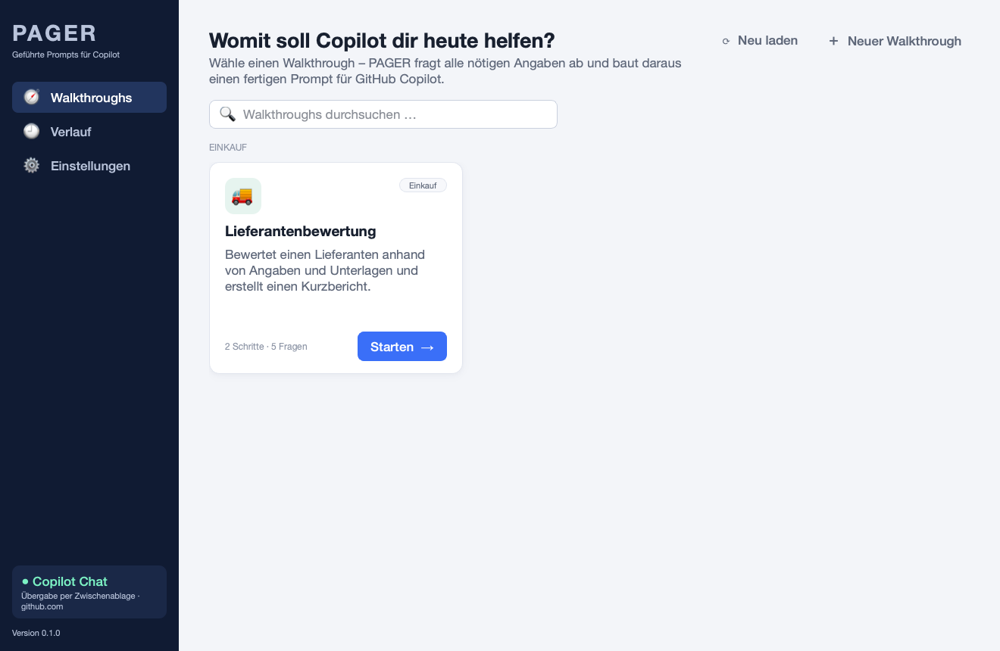
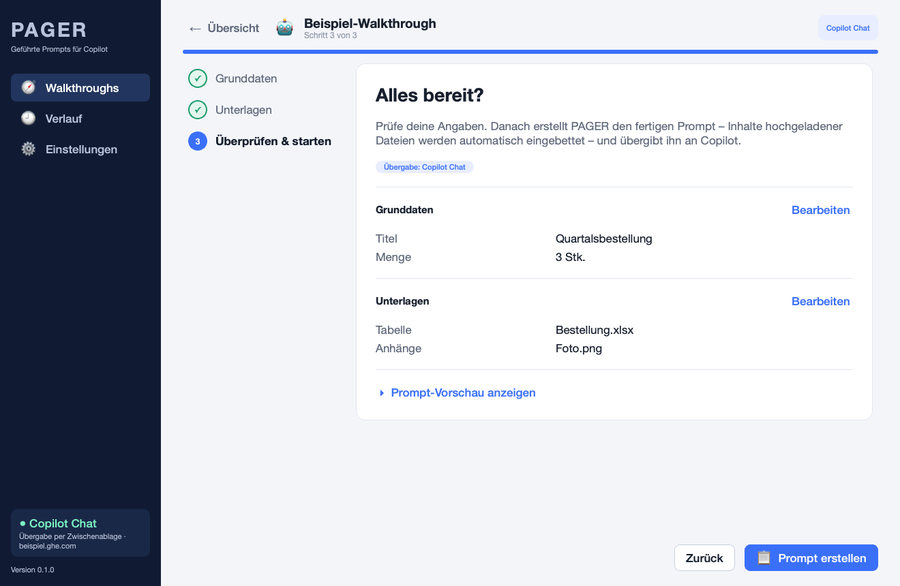
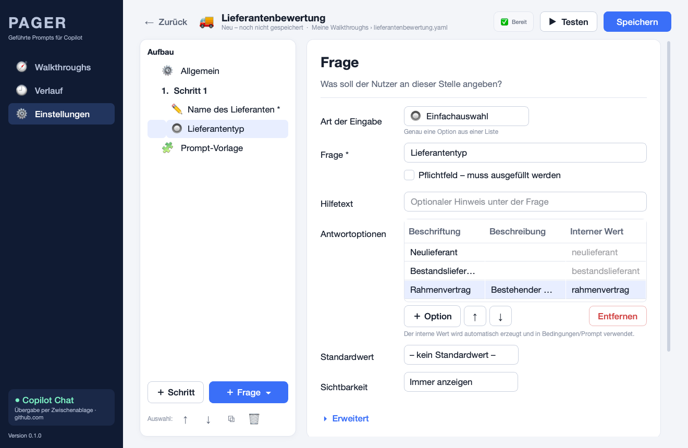
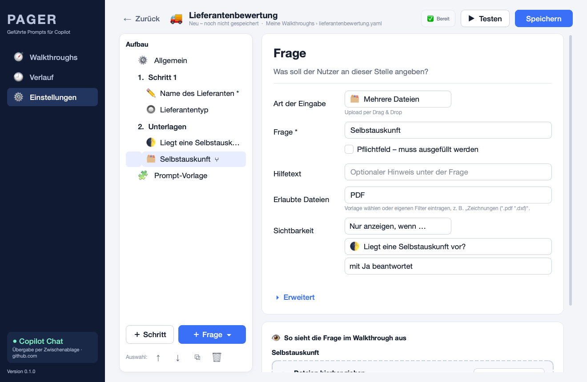
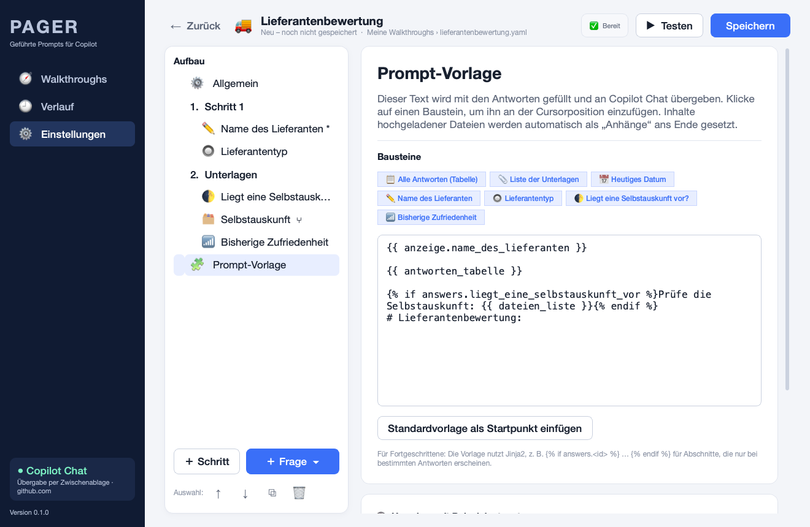
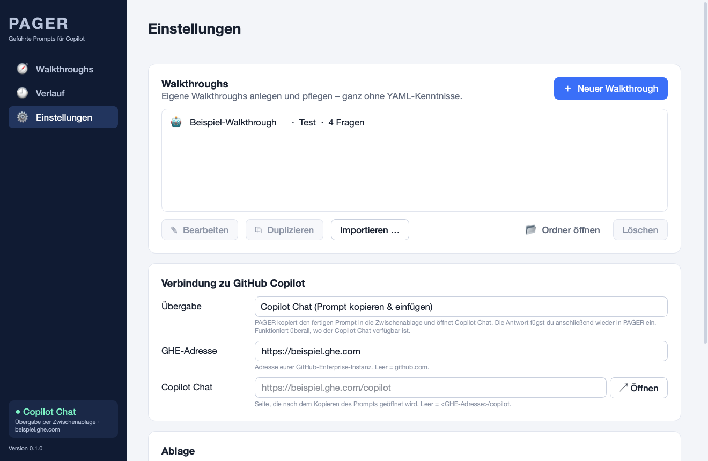
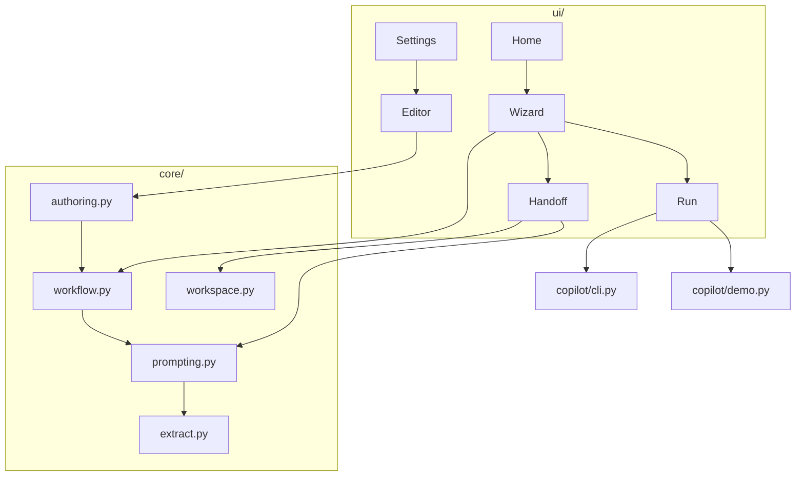

<div align="center">

# PAGER

**Geführte Prompts für GitHub Copilot – ohne Prompt-Engineering-Kenntnisse.**

PAGER führt Schritt für Schritt durch alle Angaben, die für eine gute Copilot-Antwort nötig sind,
und baut daraus einen fertigen Prompt. Hochgeladene Dateien werden direkt eingebettet. Der
Prompt geht an Copilot Chat, die Antwort landet im Verlauf und lässt sich als PDF exportieren.


-41CD52?logo=qt&logoColor=white)




</div>

---

## Inhalt

- [Warum PAGER?](#warum-pager)
- [So funktioniert es](#so-funktioniert-es)
- [Funktionen](#funktionen)
- [Screenshots](#screenshots)
- [Installation & Start](#installation--start)
- [Einrichtung](#einrichtung)
- [Walkthroughs erstellen](#walkthroughs-erstellen)
- [Prompt-Vorlagen](#prompt-vorlagen)
- [Dateien & Anhänge](#dateien--anhänge)
- [Übergabe-Modi](#übergabe-modi)
- [Daten & Ablage](#daten--ablage)
- [Architektur](#architektur)
- [Entwicklung](#entwicklung)
- [Build & Verteilung](#build--verteilung)
- [Roadmap](#roadmap)
- [FAQ](#faq)

---

## Warum PAGER?

Gute Ergebnisse von Copilot hängen am Prompt: Fehlt der Kontext, wird die Antwort vage.
Teams entwickeln deshalb bewährte Prompts für wiederkehrende Aufgaben, aber jeder Kollege
muss sie kennen, richtig ausfüllen und die passenden Unterlagen beilegen.

PAGER macht aus einem bewährten Prompt einen **geführten Walkthrough**:

| Ohne PAGER | Mit PAGER |
|---|---|
| Prompt aus einer Wiki-Seite kopieren und Platzhalter selbst ersetzen | Fragebogen mit Pflichtfeldern, Auswahllisten und Prüfung der Eingaben |
| Excel-Tabellen oder PDFs von Hand in den Chat kopieren | Dateien per Drag & Drop, der Inhalt wird automatisch eingebettet |
| Jeder formuliert anders, die Ergebnisse sind nicht vergleichbar | Einheitliche Vorlage für das ganze Team |
| Antworten verschwinden im Chatverlauf | Verlauf mit Angaben, Prompt und Antwort sowie PDF-Export |

**Wichtig:** PAGER braucht **nur Zugriff auf Copilot Chat**. Custom Agents, eigene
Repositories, Copilot CLI und Admin-Rechte sind nicht nötig.

## So funktioniert es



1. **Walkthrough wählen.** Die Startseite zeigt alle Walkthroughs des Teams als Kacheln.
2. **Fragen beantworten.** Schritt für Schritt, mit Pflichtfeldern, Hilfetexten und Fragen, die
   nur bei bestimmten Antworten erscheinen.
3. **Prompt erstellen.** PAGER füllt die Prompt-Vorlage aus, bettet Dateiinhalte ein und kopiert
   alles in die Zwischenablage.
4. **Copilot Chat.** Ein Klick öffnet den Chat eurer GHE-Instanz. Dort mit `Strg+V` einfügen
   und absenden.
5. **Antwort zurückholen.** Die Antwort kopieren und in PAGER einfügen. Sie wird gespeichert,
   formatiert angezeigt und kann als PDF exportiert werden.

## Funktionen

<table>
<tr><td width="50%" valign="top">

**Für Anwender**
- Übersicht aller Walkthroughs mit Suche und Kategorien
- Assistent mit Schritt-Anzeige, Pflichtfeldern und Prüfung der Eingaben
- 11 Eingabetypen von Text über Zahl, Auswahl, Skala und Datum bis Datei-Upload
- Bedingte Fragen („nur anzeigen, wenn …“)
- Überprüfungsseite mit Prompt-Vorschau
- Übergabe an Copilot Chat in drei geführten Schritten
- Verlauf aller Läufe, Fortsetzen offener Übergaben
- Export als PDF oder Markdown
- „Angaben anpassen“, um einen Lauf mit geänderten Antworten zu wiederholen

</td><td width="50%" valign="top">

**Für Ersteller von Walkthroughs**
- Grafischer Editor, ohne YAML oder Programmierung
- Gliederung mit Schritten und Fragen, die sich verschieben und duplizieren lassen
- Live-Vorschau jeder Frage
- Bedingungen über Auswahllisten statt Formeln
- Prompt-Editor mit Bausteinen per Klick und Vorschau mit Beispielwerten
- Prüfung beim Bearbeiten mit verständlichen Hinweisen
- Testlauf vor dem Speichern
- Umbenennen ohne Bruch: Bedingungen und Prompt werden automatisch angepasst
- Ablage lokal oder in einem geteilten Ordner wie einem Netzlaufwerk

</td></tr>
</table>

## Screenshots

| Startseite | Walkthrough |
|---|---|
|  |  |
| **Übergabe an Copilot Chat** | **Ergebnis** |
|  |  |
| **Editor: Frage mit Optionen** | **Editor: Bedingung & Vorschau** |
|  |  |
| **Editor: Prompt-Vorlage** | **Einstellungen** |
|  |  |

## Installation & Start

### Anwender (Windows)

1. Den Ordner `PAGER` (aus dem Build, siehe [Build & Verteilung](#build--verteilung)) an einen
   beliebigen Ort kopieren.
2. `PAGER.exe` starten. Eine Installation oder Administratorrechte sind nicht nötig.
3. Einmalig die [Einrichtung](#einrichtung) vornehmen.

### Entwickler

Voraussetzung ist [uv](https://docs.astral.sh/uv/). Python 3.12 wird bei Bedarf automatisch
installiert.

```bash
git clone <repo-url> PAGER && cd PAGER
uv sync          # Abhängigkeiten installieren
uv run pager     # App starten   (alternativ: uv run python -m pager)
uv run pytest    # Tests ausführen
```

## Einrichtung

**Einstellungen → Verbindung zu GitHub Copilot**

| Feld | Beschreibung | Beispiel |
|---|---|---|
| Übergabe | So kommt der Prompt zu Copilot, siehe [Übergabe-Modi](#übergabe-modi) | `Copilot Chat` |
| GHE-Adresse | Adresse eurer GitHub-Enterprise-Instanz, leer = github.com | `https://<instanz>.ghe.com` |
| Copilot Chat | Seite, die nach dem Kopieren geöffnet wird, leer = `<GHE-Adresse>/copilot` | – |

Unter **Ablage** lassen sich ein oder mehrere **geteilte Ordner** eintragen, z. B. ein
Netzlaufwerk, auf dem das Team seine Walkthroughs gemeinsam pflegt.

> Die GHE-Adresse wird nur lokal in den Einstellungen gespeichert und steht nicht im Code.

## Walkthroughs erstellen

**Einstellungen → Walkthroughs → ＋ Neuer Walkthrough**, oder über „＋ Neuer Walkthrough“ auf
der Startseite. Bestehende Walkthroughs öffnet man per Rechtsklick auf die Kachel und
„Bearbeiten“.

| Bereich | Inhalt |
|---|---|
| ⚙️ **Allgemein** | Name, Beschreibung, Symbol, Farbe, Kategorie, Speicherort |
| 📁 **Schritte** | Eine Seite im Assistenten mit Titel, Beschreibung und optionaler Bedingung |
| ✏️ **Fragen** | Art der Eingabe, Fragetext, Pflichtfeld, Hilfetext, Optionen, Wertebereich, Einheit, Standardwert, Bedingung |
| 🧩 **Prompt-Vorlage** | Text mit Bausteinen, aus dem der Prompt entsteht |

### Eingabetypen

| Typ | Darstellung | Typische Verwendung |
|---|---|---|
| ✏️ Kurzer Text | Eingabezeile | Namen, Nummern |
| 📝 Langer Text | mehrzeiliges Feld | Beschreibungen, Hinweise |
| 🔢 Ganze Zahl / ➗ Dezimalzahl | Zahlenfeld mit Einheit, deutsches Zahlenformat | Mengen, Preise |
| 🔘 Einfachauswahl | Kacheln (≤ 4 Optionen) oder Liste | Kategorien |
| ☑️ Mehrfachauswahl | Checkboxen | Kriterien, Regionen |
| 🌓 Ja / Nein | Umschalter | Entscheidungen, Auslöser für Bedingungen |
| 📶 Skala | Bewertung 1–5 mit Beschriftung | Prioritäten, Einschätzungen |
| 📅 Datum | Kalender | Termine |
| 📄 / 🗂️ Datei(en) | Drag & Drop mit Dateifilter | Tabellen, Dokumente |

### Bedingungen

Fragen und ganze Schritte lassen sich abhängig von einer vorherigen Antwort ein- oder
ausblenden:

- **Ja/Nein:** „mit Ja beantwortet“ / „mit Nein beantwortet“
- **Auswahl:** „ist“, „ist nicht“, „ist eine von …“, „ist beantwortet“
- **Text/Zahl:** „ist ausgefüllt“, „ist gleich“, „ist ungleich“

Ausgeblendete Fragen werden nicht abgefragt und erscheinen nicht im Prompt.

## Prompt-Vorlagen

Die Vorlage ist normaler Text mit Platzhaltern. Im Editor fügt ein Klick auf einen Baustein den
passenden Platzhalter ein. Bleibt die Vorlage leer, verwendet PAGER eine Standardvorlage, die alle
Antworten als Tabelle auflistet.

```jinja
# Aufgabe: Bewertung für {{ anzeige.lieferant }}

Bewerte den Lieferanten anhand der folgenden Angaben.

{{ antworten_tabelle }}


Berücksichtige insbesondere die Selbstauskunft: {{ dateien_liste }}


Antworte als Markdown-Bericht mit Empfehlung, Begründung und offenen Punkten.
```

| Platzhalter | Inhalt |
|---|---|
| `{{ anzeige.<id> }}` | Antwort lesbar formatiert, z. B. `12.000 Stk.`, `Ja` oder die Beschriftung einer Option |
| `{{ answers.<id> }}` | Rohwert, z. B. für Bedingungen: ` … ` |
| `{{ antworten_tabelle }}` | Alle sichtbaren Antworten als Markdown-Tabelle |
| `{{ dateien_liste }}` | Liste der Unterlagen mit Verweis auf den jeweiligen Anhang |
| `{{ heute }}` | Heutiges Datum (TT.MM.JJJJ) |
| `{{ workflow.name }}`, `{{ workflow.description }}` | Name und Beschreibung des Walkthroughs |

Die Vorlagen verwenden die [Jinja2-Syntax](https://jinja.palletsprojects.com/en/stable/templates/).
Für einfache Vorlagen reichen die Bausteine.

## Dateien & Anhänge

Copilot Chat kann keine lokalen Dateien lesen. PAGER **bettet deshalb den Inhalt hochgeladener
Dateien als Text in den Prompt ein**, im Abschnitt „Anhänge“ am Ende.

| Format | Behandlung |
|---|---|
| Excel (`.xlsx`, `.xlsm`) | jedes Blatt als Markdown-Tabelle (bis 500 Zeilen × 40 Spalten) |
| PDF | Text je Seite (bis 60 Seiten; gescannte PDFs enthalten keinen Text) |
| Word (`.docx`) | Fließtext |
| Textformate (`.txt`, `.md`, `.csv`, `.json`, `.xml`, …) | unverändert |
| Bilder und andere Binärdateien | nicht einbettbar: PAGER weist darauf hin, diese Dateien im Chat selbst anzuhängen |

Je Datei werden höchstens 40.000 Zeichen eingebettet. Ab 100.000 Zeichen Gesamtlänge warnt PAGER,
weil Chat-Eingaben begrenzt sind.

## Übergabe-Modi

| Modus | Ablauf | Voraussetzung |
|---|---|---|
| **Copilot Chat** *(Standard)* | Prompt in die Zwischenablage, Chat öffnen, Antwort zurück in PAGER einfügen | Zugriff auf Copilot Chat |
| **Copilot CLI** *(optional)* | PAGER sendet den Prompt automatisch und zeigt die Antwort live an | [GitHub Copilot CLI](https://docs.github.com/en/copilot/how-tos/copilot-cli) installiert und freigegeben, Anmeldung per `copilot login --host <GHE-Adresse>` |
| **Demo** | Antworten werden simuliert | – |

Im CLI-Modus ruft PAGER `copilot -p "Lies @AUFTRAG.md …" --silent` im Arbeitsordner des Laufs
auf. Custom Agents oder Repositories werden auch dafür nicht benötigt.

## Daten & Ablage

| Was | Wo (Windows) | Inhalt |
|---|---|---|
| Einstellungen | `%APPDATA%\PAGER\settings.json` | Übergabe-Modus, GHE-Adresse, Ordner |
| Eigene Walkthroughs | `%APPDATA%\PAGER\workflows\*.yaml` | Fragebogen und Prompt-Vorlage |
| Geteilte Walkthroughs | frei wählbar (Einstellungen → Ablage) | z. B. Netzlaufwerk des Teams |
| Verlauf | `%LOCALAPPDATA%\PAGER\runs\<datum>_<walkthrough>\` | `AUFTRAG.md` (Prompt), `eingaben/` (Kopien der Dateien), Ergebnis, `meta.json` |

PAGER selbst sendet keine Daten ins Netz. Die Übergabe an Copilot übernimmt im Chat-Modus der
Nutzer selbst. Es gelten die Copilot-Richtlinien eurer Organisation.

<details>
<summary><b>Walkthrough-Dateiformat (YAML)</b></summary>

Der Editor speichert Walkthroughs als lesbare YAML-Dateien. Man kann sie auch von Hand bearbeiten
und per **Importieren …** übernehmen.

```yaml
id: lieferantenbewertung
name: Lieferantenbewertung
description: Bewertet einen Lieferanten anhand von Angaben und Unterlagen.
category: Einkauf
icon: 🚚
color: '#1F9D6B'
steps:
- id: grunddaten
  title: Grunddaten
  questions:
  - id: lieferant
    label: Name des Lieferanten
    type: text
    required: true
  - id: typ
    label: Lieferantentyp
    type: choice
    options:
    - {value: neu, label: Neulieferant}
    - {value: bestand, label: Bestandslieferant}
- id: unterlagen
  title: Unterlagen
  questions:
  - id: selbstauskunft_vorhanden
    label: Liegt eine Selbstauskunft vor?
    type: bool
  - id: selbstauskunft
    label: Selbstauskunft
    type: files
    filter: PDF (*.pdf);;Alle Dateien (*)
    show_if: {question: selbstauskunft_vorhanden, equals: true}
prompt: |
  Bewerte {{ anzeige.lieferant }} ({{ anzeige.typ }}).
  {{ antworten_tabelle }}
```

Felder einer Frage: `id`, `label`, `type`, `required`, `help`, `placeholder`, `default`,
`options`, `min`, `max`, `unit`, `filter`, `scale_labels`, `show_if`.
Bedingungen: `show_if: <id>` (wahr/ausgefüllt) oder
`show_if: {question: <id>, equals | not_equals | in: …}`.
</details>

## Architektur

```text
src/pager/
├── app.py                 Einstiegspunkt (QApplication, Theme, Hauptfenster)
├── config.py              Einstellungen + Pfade (platformdirs)
├── core/                  UI-unabhängige Logik – vollständig getestet
│   ├── workflow.py          Datenmodell (pydantic), Validierung, Bedingungen, YAML laden
│   ├── authoring.py         Editor-Logik: Entwürfe, IDs, Umbenennen, Prüfung, YAML speichern
│   ├── prompting.py         Prompt bauen: Jinja2-Vorlage + eingebettete Anhänge
│   ├── extract.py           Text aus Excel / PDF / Word / Textdateien
│   └── workspace.py         Arbeitsordner je Lauf, Verlauf
├── copilot/               Automatische Backends (gemeinsame Schnittstelle)
│   ├── cli.py               GitHub Copilot CLI: Subprozess, Streaming, Abbruch, Timeout
│   └── demo.py              Simulierte Antworten
└── ui/                    PySide6-Oberfläche
    ├── main_window.py       Navigation, Abläufe
    ├── theme.py             Farben, Stylesheet
    ├── pages/               home · wizard · handoff · run · history · settings · editor
    └── widgets/             Eingabefelder je Fragetyp, Stepper, Editor-Bausteine
```



**Grundsätze**
- `core/` kennt keine UI. Neue Oberflächen (z. B. Web) oder Backends lassen sich ergänzen.
- Ein Walkthrough ist reine Konfiguration (YAML), es wird kein Code ausgeführt.
- Jeder Lauf ist im Arbeitsordner vollständig nachvollziehbar.

## Entwicklung

```bash
uv run pytest -q            # 33 Tests: Modell, Editor-Logik, Prompt, Extraktion, CLI (mit Fake-CLI)
uv run pager                # App starten
```

**Neuen Fragetyp hinzufügen**
1. `QuestionType` in `core/workflow.py` erweitern (Validierung und Anzeige in `Question`)
2. Widget in `ui/widgets/fields.py` von `QuestionField` ableiten und in `FIELD_TYPES` eintragen
3. Eintrag in `QUESTION_TYPES` (`core/authoring.py`) für den Editor ergänzen

**Neues Backend hinzufügen:** `copilot.base.Backend` implementieren und in
`copilot/__init__.py` (`create_backend`) sowie `config.BACKENDS` registrieren.

## Build & Verteilung

```powershell
powershell -ExecutionPolicy Bypass -File scripts\build_windows.ps1
```

Das Skript führt die Tests aus, erzeugt das Icon und baut mit PyInstaller den Ordner
`dist\PAGER\` mit `PAGER.exe`. Dieser Ordner wird verteilt, z. B. als ZIP oder per
Softwareverteilung.

## Roadmap

- [ ] Praxistest auf der Ziel-GHE mit echten Walkthroughs
- [ ] Rechte für geteilte Ordner (nur lesen / bearbeiten), Versionierung und Freigabe von Walkthroughs
- [ ] Walkthrough-Vorlagen und -Galerie zum schnellen Start
- [ ] Strukturierte Antworten (z. B. Tabellen) → Excel-Export
- [ ] Mehrstufige Dialoge (Rückfragen in derselben Chat-Sitzung)
- [ ] Installer (MSI), Auto-Update, Firmen-Theme (Logo, Farben) konfigurierbar
- [ ] Englische Oberfläche

## FAQ

<details>
<summary><b>Warum fügt PAGER den Prompt nicht selbst in Copilot Chat ein?</b></summary>

Für den Copilot Chat gibt es keine offizielle Schnittstelle, über die Drittprogramme Nachrichten
senden dürfen. PAGER bleibt deshalb bewusst bei der offiziellen Bedienung über Zwischenablage und
Browser. Ist die Copilot CLI freigegeben, kann der Modus „Copilot CLI“ den Prompt automatisch
senden.
</details>

<details>
<summary><b>Was passiert, wenn ich die Übergabe unterbreche?</b></summary>

Der Lauf bleibt im **Verlauf** mit dem Status „📋 Wartet auf Antwort“. Ein Doppelklick öffnet
die Übergabe erneut, und der Prompt wird wieder kopiert.
</details>

<details>
<summary><b>Kann ich Bilder oder gescannte PDFs verwenden?</b></summary>

Ja, aber ihr Inhalt kann nicht als Text eingebettet werden. PAGER zeigt einen Hinweis und öffnet
auf Wunsch den Ordner mit den Dateien, damit man sie im Chat selbst anhängen kann.
</details>

<details>
<summary><b>Wie teilen wir Walkthroughs im Team?</b></summary>

Einen gemeinsamen Ordner (z. B. ein Netzlaufwerk) unter **Einstellungen → Ablage** eintragen.
Im Editor wählt man beim Anlegen diesen Ordner als **Speicherort**. Alle Kollegen mit demselben
Ordner sehen den Walkthrough nach „Neu laden“.
</details>

---

<sub>Internes Projekt · privates Repository · alle Rechte vorbehalten.</sub>
