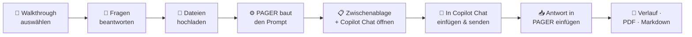
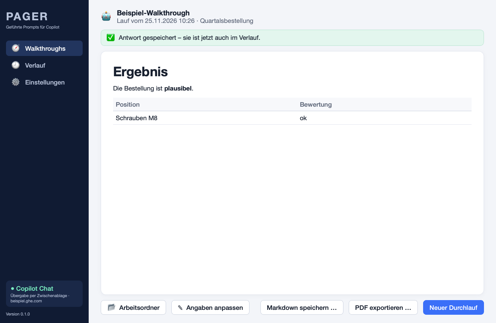
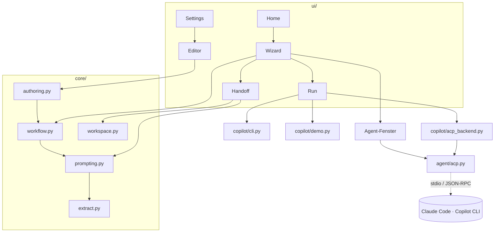

<div align="center">

# PAGER

**Geführte Prompts und KI-Agenten – ohne Prompt-Engineering-Kenntnisse.**

PAGER führt Schritt für Schritt durch alle Angaben, die für eine gute KI-Antwort nötig sind,
und baut daraus einen fertigen Prompt. Hochgeladene Dateien werden direkt eingebettet. Der
Prompt geht an Copilot Chat oder über das **Agent Client Protocol (ACP)** direkt an einen
KI-Agenten (heute Claude Code, später die GitHub Copilot CLI). In **Agent-Fenstern** sieht man den
rohen Output des Agenten und schreibt ihm direkt. Die Antwort landet im Verlauf und lässt sich als
PDF exportieren.


-41CD52?logo=qt&logoColor=white)


</div>

---

## Inhalt

- [Warum PAGER?](#warum-pager)
- [So funktioniert es](#so-funktioniert-es)
- [Funktionen](#funktionen)
- [Screenshots](#screenshots)
- [Installation & Start](#installation--start)
- [Einrichtung](#einrichtung)
- [Walkthroughs erstellen](#walkthroughs-erstellen)
- [Prompt-Vorlagen](#prompt-vorlagen)
- [Dateien & Anhänge](#dateien--anhänge)
- [Übergabe-Modi](#übergabe-modi)
- [KI-Agent über ACP](#ki-agent-über-acp)
- [Agent-Fenster](#agent-fenster)
- [Daten & Ablage](#daten--ablage)
- [Architektur](#architektur)
- [Entwicklung](#entwicklung)
- [Build & Verteilung](#build--verteilung)
- [Roadmap](#roadmap)
- [FAQ](#faq)

---

## Warum PAGER?

Gute Ergebnisse von Copilot hängen am Prompt: Fehlt der Kontext, wird die Antwort vage.
Teams entwickeln deshalb bewährte Prompts für wiederkehrende Aufgaben, aber jeder Kollege
muss sie kennen, richtig ausfüllen und die passenden Unterlagen beilegen.

PAGER macht aus einem bewährten Prompt einen **geführten Walkthrough**:

| Ohne PAGER | Mit PAGER |
|---|---|
| Prompt aus einer Wiki-Seite kopieren und Platzhalter selbst ersetzen | Fragebogen mit Pflichtfeldern, Auswahllisten und Prüfung der Eingaben |
| Excel-Tabellen oder PDFs von Hand in den Chat kopieren | Dateien per Drag & Drop, der Inhalt wird automatisch eingebettet |
| Jeder formuliert anders, die Ergebnisse sind nicht vergleichbar | Einheitliche Vorlage für das ganze Team |
| Antworten verschwinden im Chatverlauf | Verlauf mit Angaben, Prompt und Antwort sowie PDF-Export |

**Wichtig:** Im Standardmodus braucht PAGER **nur Zugriff auf Copilot Chat**. Custom Agents, eigene
Repositories, Copilot CLI und Admin-Rechte sind nicht nötig. Der Modus
[KI-Agent über ACP](#ki-agent-über-acp) ist optional.

## So funktioniert es



1. **Walkthrough wählen.** Die Seite **Start** zeigt alle Walkthroughs des Teams als Kacheln.
2. **Fragen beantworten.** Schritt für Schritt, mit Pflichtfeldern, Hilfetexten und Fragen, die
   nur bei bestimmten Antworten erscheinen.
3. **Prompt erstellen.** PAGER füllt die Prompt-Vorlage aus, bettet Dateiinhalte ein und kopiert
   alles in die Zwischenablage.
4. **Copilot Chat.** Ein Klick öffnet den Chat eurer GHE-Instanz. Dort mit `Strg+V` einfügen
   und absenden.
5. **Antwort zurückholen.** Die Antwort kopieren und in PAGER einfügen. Sie wird gespeichert,
   formatiert angezeigt und kann als PDF exportiert werden.

## Funktionen

<table>
<tr><td width="50%" valign="top">

**Für Anwender**
- Startseite mit allen Walkthroughs als Kacheln, nach Kategorien gruppiert und farbig hinterlegbar
- Assistent mit Schritt-Anzeige, Pflichtfeldern und Prüfung der Eingaben
- 11 Eingabetypen von Text über Zahl, Auswahl, Skala und Datum bis Datei-Upload
- Bedingte Fragen („nur anzeigen, wenn …“)
- Überprüfungsseite mit Prompt-Vorschau
- Übergabe an Copilot Chat in drei geführten Schritten
- Verlauf aller Läufe, Fortsetzen offener Übergaben
- Export als PDF oder Markdown
- „Angaben anpassen“, um einen Lauf mit geänderten Antworten zu wiederholen
- **Agent-Fenster:** roher Output des KI-Agenten, direkte Nachrichten, Rückfragen per Pfeiltasten,
  Werkzeug-Freigaben

</td><td width="50%" valign="top">

**Für Ersteller von Walkthroughs**
- Grafischer Editor, ohne YAML oder Programmierung
- Gliederung mit Schritten und Fragen, die sich verschieben und duplizieren lassen
- Live-Vorschau jeder Frage
- Bedingungen über Auswahllisten statt Formeln
- Prompt-Editor mit Bausteinen per Klick und Vorschau mit Beispielwerten
- Prüfung beim Bearbeiten mit verständlichen Hinweisen
- Testlauf vor dem Speichern
- Umbenennen ohne Bruch: Bedingungen und Prompt werden automatisch angepasst
- Ablage lokal oder in einem geteilten Ordner wie einem Netzlaufwerk
- Schritte vom Typ **Agent-Fenster** mit Startnachricht aus den bisherigen Antworten; jeder
  Bestandteil des Fensters lässt sich ein- und ausblenden, mit Live-Vorschau

</td></tr>
</table>

## Screenshots

| Startseite | Walkthrough |
|---|---|
|  |  |
| **Übergabe an Copilot Chat** | **Ergebnis** |
|  |  |
| **Editor: Frage mit Optionen** | **Editor: Bedingung & Vorschau** |
|  |  |
| **Editor: Prompt-Vorlage** | **Einstellungen** |
|  |  |

## Installation & Start

### Anwender

Fertige Programme gibt es unter [Releases](https://github.com/ynkblw/PAGER/releases/latest):

| System | Datei | Start |
|---|---|---|
| Windows 10/11 | `PAGER-<version>-windows.zip` (empfohlen) | entpacken, `PAGER\PAGER.exe` starten |
| Windows 10/11 | `PAGER-<version>-windows.exe` | einzelne Datei, direkt starten (startet etwas langsamer) |
| macOS 12+ (Apple Silicon) | `PAGER-<version>-macos.zip` | entpacken, `PAGER.app` nach *Programme* ziehen |

Eine Installation oder Administratorrechte sind nicht nötig. Danach einmalig die
[Einrichtung](#einrichtung) vornehmen.

Die Programme sind nicht von einem Hersteller signiert. Beim ersten Start warnt Windows deshalb
(SmartScreen: *Weitere Informationen → Trotzdem ausführen*). macOS meldet, dass PAGER nicht
geöffnet werden kann; dann unter *Systemeinstellungen → Datenschutz & Sicherheit* auf *Dennoch
öffnen* klicken.

### Entwickler

Voraussetzung ist [uv](https://docs.astral.sh/uv/). Python 3.12 wird bei Bedarf automatisch
installiert.

```bash
git clone <repo-url> PAGER && cd PAGER
uv sync          # Abhängigkeiten installieren
uv run pager     # App starten   (alternativ: uv run python -m pager)
uv run pytest    # Tests ausführen
```

## Einrichtung

**Einstellungen → Verbindung zur KI**

| Feld | Beschreibung | Beispiel |
|---|---|---|
| Übergabe | So kommt der Prompt zur KI, siehe [Übergabe-Modi](#übergabe-modi) | `Copilot Chat` |
| GHE-Adresse | Adresse eurer GitHub-Enterprise-Instanz, leer = github.com | `https://<instanz>.ghe.com` |
| Copilot Chat | Seite, die nach dem Kopieren geöffnet wird, leer = `<GHE-Adresse>/copilot` | – |

Unter **Ablage** lassen sich ein oder mehrere **geteilte Ordner** eintragen, z. B. ein
Netzlaufwerk, auf dem das Team seine Walkthroughs gemeinsam pflegt.

> Die GHE-Adresse wird nur lokal in den Einstellungen gespeichert und steht nicht im Code.

Für den Modus **KI-Agent über ACP** gibt es eine eigene grafische Einrichtung, siehe
[KI-Agent über ACP](#ki-agent-über-acp).

## Walkthroughs erstellen

**Einstellungen → Walkthroughs → ＋ Neuer Walkthrough**. Bestehende Walkthroughs öffnet man dort
oder per Rechtsklick auf die Kachel und „Bearbeiten“.

| Bereich | Inhalt |
|---|---|
| ⚙️ **Allgemein** | Name, Beschreibung, Symbol, Farbe, Hintergrund der Kachel, Kategorie, Speicherort |
| 📁 **Schritte** | Eine Seite im Assistenten mit Titel, Beschreibung und optionaler Bedingung |
| 💬 **Agent-Fenster** | Ein Schritt, der nur aus dem direkten Dialog mit dem KI-Agenten besteht, siehe [Agent-Fenster](#agent-fenster) |
| ✏️ **Fragen** | Art der Eingabe, Fragetext, Pflichtfeld, Hilfetext, Optionen, Wertebereich, Einheit, Standardwert, Bedingung |
| 🧩 **Prompt-Vorlage** | Text mit Bausteinen, aus dem der Prompt entsteht |

### Eingabetypen

| Typ | Darstellung | Typische Verwendung |
|---|---|---|
| ✏️ Kurzer Text | Eingabezeile | Namen, Nummern |
| 📝 Langer Text | mehrzeiliges Feld | Beschreibungen, Hinweise |
| 🔢 Ganze Zahl / ➗ Dezimalzahl | Zahlenfeld mit Einheit, deutsches Zahlenformat | Mengen, Preise |
| 🔘 Einfachauswahl | Kacheln (≤ 4 Optionen) oder Liste | Kategorien |
| ☑️ Mehrfachauswahl | Checkboxen | Kriterien, Regionen |
| 🌓 Ja / Nein | Umschalter | Entscheidungen, Auslöser für Bedingungen |
| 📶 Skala | Bewertung 1–5 mit Beschriftung | Prioritäten, Einschätzungen |
| 📅 Datum | Kalender | Termine |
| 📄 / 🗂️ Datei(en) | Drag & Drop mit Dateifilter | Tabellen, Dokumente |

### Bedingungen

Fragen und ganze Schritte lassen sich abhängig von einer vorherigen Antwort ein- oder
ausblenden:

- **Ja/Nein:** „mit Ja beantwortet“ / „mit Nein beantwortet“
- **Auswahl:** „ist“, „ist nicht“, „ist eine von …“, „ist beantwortet“
- **Text/Zahl:** „ist ausgefüllt“, „ist gleich“, „ist ungleich“

Ausgeblendete Fragen werden nicht abgefragt und erscheinen nicht im Prompt.

## Prompt-Vorlagen

Die Vorlage ist normaler Text mit Platzhaltern. Im Editor fügt ein Klick auf einen Baustein den
passenden Platzhalter ein. Bleibt die Vorlage leer, verwendet PAGER eine Standardvorlage, die alle
Antworten als Tabelle auflistet.

```jinja
# Aufgabe: Bewertung für {{ anzeige.lieferant }}

Bewerte den Lieferanten anhand der folgenden Angaben.

{{ antworten_tabelle }}


Berücksichtige insbesondere die Selbstauskunft: {{ dateien_liste }}


Antworte als Markdown-Bericht mit Empfehlung, Begründung und offenen Punkten.
```

| Platzhalter | Inhalt |
|---|---|
| `{{ anzeige.<id> }}` | Antwort lesbar formatiert, z. B. `12.000 Stk.`, `Ja` oder die Beschriftung einer Option |
| `{{ answers.<id> }}` | Rohwert, z. B. für Bedingungen: ` … ` |
| `{{ antworten_tabelle }}` | Alle sichtbaren Antworten als Markdown-Tabelle |
| `{{ dateien_liste }}` | Liste der Unterlagen mit Verweis auf den jeweiligen Anhang |
| `{{ heute }}` | Heutiges Datum (TT.MM.JJJJ) |
| `{{ workflow.name }}`, `{{ workflow.description }}` | Name und Beschreibung des Walkthroughs |
| `{{ agent.<fenster>.antwort }}` | Letzte Antwort des Agenten im Agent-Fenster `<fenster>` |
| `{{ agent.<fenster>.verlauf }}` | Ganzer Gesprächsverlauf dieses Agent-Fensters (Markdown) |
| `{{ dateien_pfade }}` | Hochgeladene Dateien mit Pfad im Arbeitsordner (für Agenten, die Dateien selbst lesen) |

Die Vorlagen verwenden die [Jinja2-Syntax](https://jinja.palletsprojects.com/en/stable/templates/).
Für einfache Vorlagen reichen die Bausteine.

## Dateien & Anhänge

Copilot Chat kann keine lokalen Dateien lesen. PAGER **bettet deshalb den Inhalt hochgeladener
Dateien als Text in den Prompt ein**, im Abschnitt „Anhänge“ am Ende.

| Format | Behandlung |
|---|---|
| Excel (`.xlsx`, `.xlsm`) | jedes Blatt als Markdown-Tabelle (bis 500 Zeilen × 40 Spalten) |
| PDF | Text je Seite (bis 60 Seiten; gescannte PDFs enthalten keinen Text) |
| Word (`.docx`) | Fließtext |
| Textformate (`.txt`, `.md`, `.csv`, `.json`, `.xml`, …) | unverändert |
| Bilder und andere Binärdateien | nicht einbettbar: PAGER weist darauf hin, diese Dateien im Chat selbst anzuhängen |

Je Datei werden höchstens 40.000 Zeichen eingebettet. Ab 100.000 Zeichen Gesamtlänge warnt PAGER,
weil Chat-Eingaben begrenzt sind.

## Übergabe-Modi

| Modus | Ablauf | Voraussetzung |
|---|---|---|
| **Copilot Chat** *(Standard)* | Prompt in die Zwischenablage, Chat öffnen, Antwort zurück in PAGER einfügen | Zugriff auf Copilot Chat |
| **KI-Agent über ACP** | PAGER spricht per [Agent Client Protocol](https://agentclientprotocol.com) direkt mit dem Agenten: Antwort live, Agent-Fenster, Werkzeug-Freigaben | Claude Code **oder** GitHub Copilot CLI, siehe [unten](#ki-agent-über-acp) |
| **Copilot CLI – Einzelaufruf** *(alt)* | `copilot -p "Lies @AUFTRAG.md …" --silent` im Arbeitsordner, ohne Rückfragen | GitHub Copilot CLI |
| **Demo** | Antworten und Agent-Fenster werden simuliert | – |

## KI-Agent über ACP

Das [Agent Client Protocol](https://agentclientprotocol.com) (ACP) ist ein offener Standard, über
den Programme mit KI-Agenten sprechen: JSON-RPC über stdin/stdout. PAGER ist dabei der *Client*
(wie ein Editor). Weil Claude Code und die GitHub Copilot CLI dasselbe Protokoll sprechen, lässt
sich der Agent später ohne Änderungen an PAGER oder an den Walkthroughs austauschen.

| Agent | So startet PAGER ihn | Anmeldung |
|---|---|---|
| **Claude Code** *(aktuell)* | offizieller Adapter [`claude-agent-acp`](https://www.npmjs.com/package/@agentclientprotocol/claude-agent-acp); nutzt die installierte Claude Code CLI (`CLAUDE_CODE_EXECUTABLE`) | `claude auth login` |
| **GitHub Copilot CLI** *(geplant)* | `copilot --acp`, GHE-Host per `COPILOT_GH_HOST` | `copilot login --host <GHE-Adresse>` |
| **Eigener Agent** | beliebiger ACP-fähiger Befehl | – |

**Einrichtung (Einstellungen → Übergabe: „KI-Agent über ACP“)**

1. **Agent wählen.** Claude Code, GitHub Copilot CLI oder eigener Agent.
2. **Einrichtung prüfen.** PAGER prüft CLI, Version, ACP-Adapter und Anmeldung und zeigt bei jedem
   Punkt, was fehlt. Die Knöpfe **Installieren …** und **Anmelden …** öffnen ein Terminalfenster mit
   dem passenden Befehl.
3. **Verbindung testen.** Startet den Agenten, öffnet eine ACP-Sitzung und beendet sie wieder.
   Dabei wird keine Nachricht an die KI geschickt. Angezeigt werden Agent, Version, Modi und Modelle.
4. **Freigaben festlegen.** Regel für Werkzeugaufrufe des Agenten:

   | Regel | Verhalten |
   |---|---|
   | Jedes Mal nachfragen *(Standard)* | PAGER zeigt jede Anfrage mit den Optionen des Agenten an |
   | Lesen automatisch erlauben | Lesen, Suchen und Nachdenken ohne Rückfrage, sonst nachfragen |
   | Alle Werkzeuge ablehnen | Agent antwortet nur mit Text |
   | Alles automatisch erlauben | keine Rückfragen (Vorsicht) |

5. Optional: **Modell**, **Parameter**, **Zeitlimit** und **MCP-Server**. MCP-Server werden jeder
   Sitzung mitgegeben, zum Beispiel später der TIA-MCP-Server.

Der Adapter für Claude Code braucht Node.js. Ist er nicht installiert, startet PAGER ihn über
`npx -y @agentclientprotocol/claude-agent-acp`; der erste Start dauert dann etwas länger. Schneller
geht es mit `npm install -g @agentclientprotocol/claude-agent-acp` (Knopf **Installieren …**).

PAGER bietet dem Agenten über ACP bewusst **keinen** eigenen Datei- oder Terminalzugriff an. Der
Agent arbeitet mit seinen eigenen Werkzeugen im Arbeitsordner des Laufs, und jede Freigabe läuft
über PAGER. Angeboten werden dagegen **Rückfragen als Formular** (ACP `elicitation/create`).
Darüber stellt Claude Code seine Auswahlfragen (`AskUserQuestion`), die Copilot CLI ihre
`ask_user`-Fragen. Ohne diese Fähigkeit schaltet der Claude-Adapter das Rückfrage-Werkzeug ab.

## Agent-Fenster

Ein Schritt im Walkthrough kann statt Fragen ein **Agent-Fenster** sein: der direkte Draht zum
KI-Agenten.

- Der **rohe Output** erscheint so, wie er ankommt: Antworttext, Gedanken, Werkzeugaufrufe, Plan
  und Freigabe-Anfragen.
- **Rückfragen** des Agenten erscheinen als Auswahlliste: `↑`/`↓` wählen, `Leertaste` kreuzt bei
  Mehrfachauswahl an, `Enter` antwortet. Darunter steht ein Feld für eine eigene Antwort.
  „Überspringen“ teilt dem Agenten mit, dass keine Antwort kommt.
- Optional blendet der Knopf **Rohdaten** jede ACP-Nachricht ein (`→` an den Agenten, `←` vom
  Agenten, `!` Fehlerausgabe). Er ist standardmäßig aus.
- Unten schreibt man dem Agenten direkt (`Strg+Enter` sendet). **Abbrechen** stoppt die laufende
  Antwort.
- Bietet der Agent Modi oder Modelle an, lassen sie sich im Fenster umschalten.
- Freigabe-Anfragen erscheinen direkt im Fenster, mit den Optionen des Agenten.

Im Editor legt man es über **＋ Schritt ▾ → 💬 Agent-Fenster** an. Einstellungen:

| Einstellung | Bedeutung |
|---|---|
| Startnachricht | Erste Nachricht an den Agenten, mit denselben Bausteinen wie die Prompt-Vorlage. Leer = der Nutzer beginnt |
| Automatisch senden | Startnachricht beim Öffnen sofort senden (sonst per Knopf) |
| „Weiter“ erst nach Antwort | Der Schritt gilt erst als erledigt, wenn der Agent geantwortet hat |
| Eingabehinweis | Grauer Text im leeren Eingabefeld |

Unter **Anzeige** legt man fest, welche Bestandteile sichtbar sind. Eine Live-Vorschau mit
Beispielinhalt zeigt die Wirkung sofort.

| Bestandteil | YAML-Schlüssel | Standard |
|---|---|---|
| Statuszeile (Status, Agent, „Abbrechen“) | `show_status` | an |
| Modus/Modell-Wahl (falls angeboten) | `show_controls` | an |
| Gedanken des Agenten | `show_thoughts` | an |
| Werkzeugaufrufe und Freigabe-Hinweise | `show_tools` | an |
| Plan | `show_plan` | an |
| Systemhinweise („Verbunden“, „Ende der Antwort“) | `show_system` | an |
| Eingabefeld | `show_input` | an |
| Knopf „Rohdaten“ | `raw_toggle` | aus |
| Rohdaten von Anfang an zeigen | `show_raw` | aus |

Antworttext, Rückfragen und Freigabe-Anfragen sind immer sichtbar.

Alle Agent-Fenster eines Laufs teilen sich **eine Sitzung**. Der abschließende Auftrag läuft in
derselben Sitzung, der Agent kennt also das bisherige Gespräch. Die Verläufe liegen als
`agent_<schritt>.md` im Arbeitsordner. Ohne ACP-Agent (Modus Copilot Chat) lässt sich der Schritt
überspringen.

```yaml
- id: direktkontakt
  title: Direkter Draht zum Agenten
  kind: agent
  agent:
    prompt: |
      Prüfe die Angaben zu {{ anzeige.thema }} und stelle Rückfragen.
    show_thoughts: false    # Anzeige-Schalter, siehe Tabelle oben
    # auto_start: true, require_reply: true, placeholder: "…"
```

### Beispiel: „Agent-Direktkontakt (Test)“

PAGER bringt einen vorkonfigurierten Walkthrough mit, um die direkte Kommunikation mit dem Agenten
zu testen (Kategorie *Test & Einrichtung*):

1. **Vorbereitung:** Thema, Antwortstil und ob ein Werkzeug benutzt werden soll.
2. **Direkter Draht zum Agenten:** Agent-Fenster. Der Agent stellt sich vor, nennt sein
   Arbeitsverzeichnis, legt auf Wunsch `pager_test.txt` an (Freigabe-Test) und stellt zum Schluss
   eine Rückfrage mit Auswahl (Pfeiltasten). Danach kann man frei weiterschreiben.
3. **Rückmeldung:** Hat es funktioniert? Notizen.
4. **Abschluss:** Der Agent schreibt in derselben Sitzung ein Testprotokoll.

Mitgelieferte Beispiele sind schreibgeschützt: **Bearbeiten** legt eine eigene Kopie an. Unter
Einstellungen → Ablage lassen sie sich ausblenden. Im Demo-Modus funktioniert der Walkthrough ohne
KI. Schreibt man dort `/werkzeug`, simuliert der Demo-Agent eine Freigabe-Anfrage, bei `/frage`
eine Rückfrage.

## Daten & Ablage

| Was | Wo (Windows) | Inhalt |
|---|---|---|
| Einstellungen | `%APPDATA%\PAGER\settings.json` | Übergabe-Modus, GHE-Adresse, Agent, Freigaben, MCP-Server, Ordner |
| Eigene Walkthroughs | `%APPDATA%\PAGER\workflows\*.yaml` | Fragebogen und Prompt-Vorlage |
| Geteilte Walkthroughs | frei wählbar (Einstellungen → Ablage) | z. B. Netzlaufwerk des Teams |
| Verlauf | `%LOCALAPPDATA%\PAGER\runs\<datum>_<walkthrough>\` | `AUFTRAG.md` (Prompt), `eingaben/` (Kopien der Dateien), `agent_<schritt>.md` (Verläufe), Ergebnis, `meta.json` |

PAGER selbst sendet keine Daten ins Netz. Die Übergabe an Copilot übernimmt im Chat-Modus der
Nutzer selbst. Im ACP-Modus sendet der gewählte Agent (Claude Code / Copilot CLI) die Daten an
seinen Dienst. Es gelten die KI-Richtlinien eurer Organisation.

<details>
<summary><b>Walkthrough-Dateiformat (YAML)</b></summary>

Der Editor speichert Walkthroughs als lesbare YAML-Dateien. Man kann sie auch von Hand bearbeiten
und per **Importieren …** übernehmen.

```yaml
id: lieferantenbewertung
name: Lieferantenbewertung
description: Bewertet einen Lieferanten anhand von Angaben und Unterlagen.
category: Einkauf
icon: 🚚
color: '#1F9D6B'
background: '#E3F5EC'   # optional: Kachel farbig hinterlegen
steps:
- id: grunddaten
  title: Grunddaten
  questions:
  - id: lieferant
    label: Name des Lieferanten
    type: text
    required: true
  - id: typ
    label: Lieferantentyp
    type: choice
    options:
    - {value: neu, label: Neulieferant}
    - {value: bestand, label: Bestandslieferant}
- id: unterlagen
  title: Unterlagen
  questions:
  - id: selbstauskunft_vorhanden
    label: Liegt eine Selbstauskunft vor?
    type: bool
  - id: selbstauskunft
    label: Selbstauskunft
    type: files
    filter: PDF (*.pdf);;Alle Dateien (*)
    show_if: {question: selbstauskunft_vorhanden, equals: true}
prompt: |
  Bewerte {{ anzeige.lieferant }} ({{ anzeige.typ }}).
  {{ antworten_tabelle }}
```

Felder einer Frage: `id`, `label`, `type`, `required`, `help`, `placeholder`, `default`,
`options`, `min`, `max`, `unit`, `filter`, `scale_labels`, `show_if`.
Bedingungen: `show_if: <id>` (wahr/ausgefüllt) oder
`show_if: {question: <id>, equals | not_equals | in: …}`.
</details>

## Architektur

```text
src/pager/
├── app.py                 Einstiegspunkt (QApplication, Theme, Hauptfenster)
├── config.py              Einstellungen + Pfade (platformdirs)
├── core/                  UI-unabhängige Logik – vollständig getestet
│   ├── workflow.py          Datenmodell (pydantic), Validierung, Bedingungen, YAML laden
│   ├── authoring.py         Editor-Logik: Entwürfe, IDs, Umbenennen, Prüfung, YAML speichern
│   ├── prompting.py         Prompt bauen: Jinja2-Vorlage + eingebettete Anhänge
│   ├── extract.py           Text aus Excel / PDF / Word / Textdateien
│   └── workspace.py         Arbeitsordner je Lauf, Verlauf
├── agent/                 KI-Agenten über ACP (UI-unabhängig, getestet)
│   ├── acp.py               ACP-Client: JSON-RPC über stdio, Sitzung, Updates, Freigaben, Rückfragen, Abbruch
│   ├── session.py           Sitzungs-Schnittstelle, Gesprächsverlauf
│   ├── events.py            Ereignisse (Text, Werkzeug, Freigabe, Rohdaten …) und Freigabe-Regeln
│   ├── profiles.py          Claude Code / Copilot CLI / eigener Agent: Start, Prüfung, Anmeldung
│   └── demo.py              Simulierter Agent
├── copilot/               Backends für den abschließenden Auftrag (gemeinsame Schnittstelle)
│   ├── acp_backend.py       KI-Agent über ACP (nutzt die Sitzung des Agent-Fensters weiter)
│   ├── cli.py               GitHub Copilot CLI, Einzelaufruf (alt)
│   └── demo.py              Simulierte Antworten
├── resources/workflows/   Mitgelieferte Beispiel-Walkthroughs
└── ui/                    PySide6-Oberfläche
    ├── main_window.py       Navigation, Abläufe
    ├── theme.py             Farben, Stylesheet
    ├── pages/               home · wizard · handoff · run · history · settings · editor
    └── widgets/             Eingabefelder, Stepper, Editor-Bausteine, Agent-Fenster, Agent-Einrichtung
```



**Grundsätze**
- `core/` kennt keine UI. Neue Oberflächen (z. B. Web) oder Backends lassen sich ergänzen.
- Ein Walkthrough ist reine Konfiguration (YAML), es wird kein Code ausgeführt.
- Jeder Lauf ist im Arbeitsordner vollständig nachvollziehbar.

## Entwicklung

```bash
uv run pytest -q            # 51 Tests: Modell, Editor, Prompt, Extraktion, CLI, ACP (mit simuliertem Agenten)
uv run pager                # App starten
```

**Neuen Fragetyp hinzufügen**
1. `QuestionType` in `core/workflow.py` erweitern (Validierung und Anzeige in `Question`)
2. Widget in `ui/widgets/fields.py` von `QuestionField` ableiten und in `FIELD_TYPES` eintragen
3. Eintrag in `QUESTION_TYPES` (`core/authoring.py`) für den Editor ergänzen

**Neues Backend hinzufügen:** `copilot.base.Backend` implementieren und in
`copilot/__init__.py` (`create_backend`) sowie `config.BACKENDS` registrieren.

**Weiteren ACP-Agenten fest einbauen:** in `agent/profiles.py` ein Profil in `AGENTS` ergänzen und
in `build_launch` (Startbefehl), `run_checks` (Einrichtungsprüfung) und `login_command` behandeln.
Für einen einmaligen Test reicht „Eigener ACP-Agent“ in den Einstellungen.

## Build & Verteilung

**Automatisch (GitHub Actions):** Ein Tag `v*` startet [`.github/workflows/release.yml`](.github/workflows/release.yml).
Der Workflow baut auf Windows und macOS, führt die Tests aus und veröffentlicht ein Release mit
allen Dateien. Den Text des Releases liefert [`.github/release-notes.md`](.github/release-notes.md).

```bash
# Version in pyproject.toml und src/pager/__init__.py anheben, committen, dann:
git tag v0.2.0 && git push origin v0.2.0
```

**Lokal:** Gebaut wird immer für das System, auf dem das Skript läuft. Windows-Programme
lassen sich also nicht auf dem Mac bauen.

```bash
uv run python scripts/build.py --package             # macOS: dist/PAGER.app, release/*.zip
uv run python scripts/build.py --onefile --package   # Windows: dist\PAGER\PAGER.exe + Einzeldatei
```

Unter Windows erledigt `scripts\build_windows.ps1` das samt Tests. Das Skript erzeugt das Icon
aus `resources/pager.svg`, baut mit PyInstaller und packt die Ergebnisse nach `release/`. Auf
macOS wird das Bundle ad hoc signiert; eine Notarisierung durch Apple erfolgt nicht.

## Roadmap

- [x] KI-Agent über ACP (Claude Code) mit Agent-Fenster und Freigaben
- [ ] Umstellung auf die GitHub Copilot CLI (`copilot --acp`) auf der Ziel-GHE
- [ ] TIA-Integration über Agent-Fenster und TIA-MCP-Server
- [ ] Praxistest auf der Ziel-GHE mit echten Walkthroughs
- [ ] Rechte für geteilte Ordner (nur lesen / bearbeiten), Versionierung und Freigabe von Walkthroughs
- [ ] Walkthrough-Vorlagen und -Galerie zum schnellen Start
- [ ] Strukturierte Antworten (z. B. Tabellen) → Excel-Export
- [x] Mehrstufige Dialoge (Agent-Fenster, gemeinsame ACP-Sitzung)
- [x] Fertige Programme für Windows (.exe) und macOS (.app) über GitHub Releases
- [ ] Installer (MSI), Signierung/Notarisierung, Auto-Update, Firmen-Theme konfigurierbar
- [ ] Englische Oberfläche

## FAQ

<details>
<summary><b>Warum fügt PAGER den Prompt nicht selbst in Copilot Chat ein?</b></summary>

Für den Copilot Chat gibt es keine offizielle Schnittstelle, über die Drittprogramme Nachrichten
senden dürfen. PAGER bleibt deshalb bewusst bei der offiziellen Bedienung über Zwischenablage und
Browser. Ist die Copilot CLI freigegeben, kann der Modus „Copilot CLI“ den Prompt automatisch
senden.
</details>

<details>
<summary><b>Was passiert, wenn ich die Übergabe unterbreche?</b></summary>

Der Lauf bleibt im **Verlauf** mit dem Status „📋 Wartet auf Antwort“. Ein Doppelklick öffnet
die Übergabe erneut, und der Prompt wird wieder kopiert.
</details>

<details>
<summary><b>Kann ich Bilder oder gescannte PDFs verwenden?</b></summary>

Ja, aber ihr Inhalt kann nicht als Text eingebettet werden. PAGER zeigt einen Hinweis und öffnet
auf Wunsch den Ordner mit den Dateien, damit man sie im Chat selbst anhängen kann.
</details>

<details>
<summary><b>Wie teilen wir Walkthroughs im Team?</b></summary>

Einen gemeinsamen Ordner (z. B. ein Netzlaufwerk) unter **Einstellungen → Ablage** eintragen.
Im Editor wählt man beim Anlegen diesen Ordner als **Speicherort**. Alle Kollegen mit demselben
Ordner sehen den Walkthrough, sobald sie die Seite **Start** öffnen.
</details>

---

<sub>Internes Projekt · privates Repository · alle Rechte vorbehalten.</sub>
